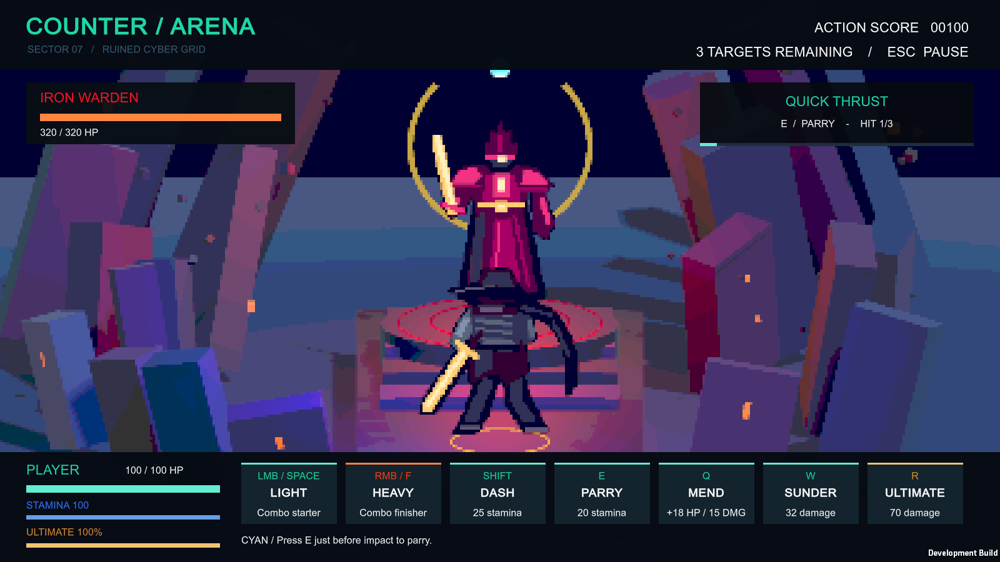

# COUNTER / ARENA — Unity C#

Playable Unity port of the original browser combat prototype, now presented with **pixel art characters and a pixel-rendered 2.5D world**. The battle scene uses a fixed rear view: the hunter in the foreground, the enemy centered on an elevated dais, and layered scenery behind them. Audio and effects remain prototype assets.



## Open and play

Team browser playtest: **https://lnwzavbvb-tech.github.io/My-game/**. The footer shows the installed version, links to bug reports and offers a reload button. After an update is published, players use the same URL.

1. In Unity Hub, add this repository folder (`My-game`) as a project.
2. Open with **Unity 6000.6.2f1**.
3. Open `Assets/CounterArena/Scenes/Sector07.unity` and press Play.
4. Click **ENTER SECTOR** or press Enter.

The latest local Windows build with the restart fix is `Builds/Windows-RestartFix/CounterArena.exe`. Build output is excluded from Git. To share the build, distribute that entire folder, including the executable, data folder and DLLs. The default build command below writes to `Builds/Windows`; add `-arenaBuildFolder Builds/Windows-RestartFix` to select a different output folder.

## Controls

| Mode | Input | Action |
| --- | --- | --- |
| Explore | WASD / Arrow keys | Move on the ground plane |
| Explore | Shift / Space | Sprint |
| Explore | Approach an enemy | Enter battle |
| Battle | LMB / Space | Light attack |
| Battle | RMB / F / K | Heavy attack |
| Battle | Shift | Dash: 25 stamina, 0.45s invulnerability |
| Battle | E | Parry: 20 stamina, 0.30s window |
| Battle | Q | Wind Mend: +18 HP, 15 damage, 8.5s cooldown |
| Battle | W | Armor Sunder: 32 damage, 4.5s cooldown |
| Battle | R | Ultimate: 100 energy, 70 damage |
| Any active mode | Escape | Pause / resume |

The battle HUD also has clickable action buttons. **Cyan attacks can be parried; orange attacks must be dodged.** Watch the windup gauge and react just before impact. Light/heavy commands chain within 1.1 seconds: LLL, LH, LLH, HL and HH.

Defeat the Sentinel (140 HP), Enforcer (220 HP), and Warden (320 HP) to clear the sector. Each victory grants 25 HP and 300 score. Health persists between encounters. Pickups and defeated enemies stay cleared until restart. Death and sector completion offer a full restart.

## Project layout

- `Assets/CounterArena/Scripts/ArenaRules.cs`: combat state, timing, combos, enemy patterns and map collision.
- `Assets/CounterArena/Scripts/ArenaGame.cs`: input, world presentation, HUD, audio and procedural animation.
- `Assets/CounterArena/Editor/ArenaProjectBuilder.cs`: reproducible scene, material and prefab creation; Windows build entry point.
- `Assets/CounterArena/Editor/ArenaValidation.cs`: deterministic gameplay and navigation checks.
- `Assets/CounterArena/Materials`: replaceable mockup materials.
- `Assets/CounterArena/Art/Pixel`: transparent pixel sprites for the hunter, Sentinel drone, armored Enforcer and robed Warden.
- `Assets/CounterArena/Editor/PixelArtAssets.cs`: reproducible pixel artwork and sprite importer settings.
- `Assets/CounterArena/Scripts/PixelActor.cs`: camera-facing sprites and discrete pose changes.
- `Assets/CounterArena/Scripts/PixelPresentation.cs`: 225-pixel-high world render with point upscaling.
- `Assets/CounterArena/Shaders/PixelPalette.shader`: discrete color bands for world rendering.
- `Assets/CounterArena/Prefabs`: hunter and Warden mockup prefabs.
- `Docs/Preview`: captures from the running Unity player.
- `Docs/WebPrototype.md`: original browser documentation. The original HTML/CSS/JS remain available at the repository root.

No third-party runtime packages or external art assets are required. Rendering uses the built-in pipeline, input uses Unity's legacy Input API, and the prototype HUD uses IMGUI. The build targets keyboard/mouse on Windows.

## Rebuild and validate

Publish the latest Unity game to the existing GitHub Pages site with:

```powershell
pwsh -File Tools/Publish-Web.ps1
```

This builds WebGL locally, replaces the generated website files, commits the Unity project and site to `main`, and pushes to the existing GitHub remote. It requires a GitHub account with push access and a valid local Unity license. GitHub Pages already publishes the repository root on `main`, so no account/repository migration is needed. Build filenames use content hashes to avoid stale game assets. The original JavaScript browser demo is retained in `LegacyWeb/`.

Use **Counter Arena → Create or rebuild mockup scene** to regenerate scene assets. This replaces the generated Sector07 scene, materials and mockup prefabs; save manual scene variants under a different name. The scene is also generated automatically on first import if it is missing.

Use **Counter Arena → Validate gameplay rules** in the Editor, or run the standalone .NET 8 check from the repository root:

```powershell
dotnet run --project Tools/Validate/Validate.csproj
```

The standalone check compiles the runtime and editor C# against the installed Unity assemblies and runs combat/map checks. It does not render or replace play testing. Override `UnityData` in the project file/MSBuild command if Unity is installed elsewhere.

To regenerate, validate and build in one command:

```powershell
& 'C:\Program Files\Unity\Hub\Editor\6000.6.2f1\Editor\Unity.exe' -batchmode -quit -projectPath $PWD.Path -executeMethod ArenaProjectBuilder.PrepareAndBuild -logFile "$PWD/unity-build.log"
```

Run the built player with `--arena-smoke` for an automated live check of pickups, proximity encounters, battle presentation and ultimate damage. It saves screenshots and a JSON result in `Builds/Windows/SmokeResults`, then exits. Run it with a visible window so screenshots can render.

## Prototype scope

The camera composition follows the supplied 2.5D reference. Characters use authored low-resolution sprites with idle/attack poses, plus guard/hurt poses for the hunter. The 3D environment is presented on a 400×225 pixel grid at 16:9, upscaled with point filtering; UI remains at display resolution for readability. Sprites use point filtering, no mipmaps and no texture compression. Extended animation clips and production audio are future work. Combat remains the original timed counter system with automatic engagement distance. There is no free camera, multiplayer or save/load system.
